# UDANPATH — COMPLETE SYSTEM ANALYSIS & DESIGN DIAGRAM SUITE

This document contains the authoritative, complete set of **39 software engineering and system architecture diagrams** for **UdanPath** (The Ultimate AI-Powered Exam Navigation & Career Architecture Platform for India).

Every diagram reflects the actual production architecture, Next.js 16 App Router structure, Supabase PostgreSQL schema, Google Gemini AI integration, and live date scraping services of the UdanPath repository.

---

## TABLE OF CONTENTS

### Section 1: UML Diagrams
1. [1. UML Use Case Diagram](#1-uml-use-case-diagram)
2. [2. UML Class Diagram](#2-uml-class-diagram)
3. [3. UML Activity Diagram](#3-uml-activity-diagram)
4. [4. UML Sequence Diagram](#4-uml-sequence-diagram)
5. [5. UML Communication Diagram](#5-uml-communication-diagram)
6. [6. UML State Machine Diagram](#6-uml-state-machine-diagram)
7. [7. UML Component Diagram](#7-uml-component-diagram)
8. [8. UML Deployment Diagram](#8-uml-deployment-diagram)
9. [9. UML Object Diagram](#9-uml-object-diagram)
10. [10. UML Package Diagram](#10-uml-package-diagram)
11. [11. UML Composite Structure Diagram](#11-uml-composite-structure-diagram)
12. [12. UML Timing Diagram](#12-uml-timing-diagram)
13. [13. UML Interaction Overview Diagram](#13-uml-interaction-overview-diagram)

### Section 2: Data Flow Diagrams (DFD)
14. [14. DFD Level 0 — Context Diagram](#14-dfd-level-0--context-diagram)
15. [15. DFD Level 1 — System Decomposition](#15-dfd-level-1--system-decomposition)
16. [16. DFD Level 2 — Process 1.0 (Auth & Session Management)](#16-dfd-level-2--process-10-auth--session-management)
17. [17. DFD Level 2 — Process 2.0 (Student Profile & Preferences)](#17-dfd-level-2--process-20-student-profile--preferences)
18. [18. DFD Level 2 — Process 3.0 (Exam Discovery & Catalog)](#18-dfd-level-2--process-30-exam-discovery--catalog)
19. [19. DFD Level 2 — Process 4.0 (Dynamic Eligibility Engine)](#19-dfd-level-2--process-40-dynamic-eligibility-engine)
20. [20. DFD Level 2 — Process 5.0 (Recommendation Engine)](#20-dfd-level-2--process-50-recommendation-engine)
21. [21. DFD Level 2 — Process 6.0 (Live Scraper & Exam Data)](#21-dfd-level-2--process-60-live-scraper--exam-data)
22. [22. DFD Level 2 — Process 7.0 (Study Resources & PYQs Hub)](#22-dfd-level-2--process-70-study-resources--pyqs-hub)
23. [23. DFD Level 2 — Process 8.0 (Roadmap & Milestone Tracking)](#23-dfd-level-2--process-80-roadmap--milestone-tracking)
24. [24. DFD Level 2 — Process 9.0 (AI Career Advisor)](#24-dfd-level-2--process-90-ai-career-advisor)
25. [25. DFD Level 2 — Process 10.0 (PDF/RAG Processing)](#25-dfd-level-2--process-100-pdfrag-processing)

### Section 3: Database Models & Schema
26. [26. Entity Relationship Diagram (ERD)](#26-entity-relationship-diagram-erd)
27. [27. Conceptual Data Model](#27-conceptual-data-model)
28. [28. Logical Data Model (LDM)](#28-logical-data-model-ldm)
29. [29. Physical Data Model (PDM)](#29-physical-data-model-pdm)
30. [30. Database Schema Diagram](#30-database-schema-diagram)
31. [31. Relational Table Diagram (PK/FK Constraints)](#31-relational-table-diagram-pkfk-constraints)

### Section 4: System Design, Architecture & Matrices
32. [32. System Architecture Diagram](#32-system-architecture-diagram)
33. [33. End-to-End System Flowchart](#33-end-to-end-system-flowchart)
34. [34. Data Dictionary (Schema Specifications)](#34-data-dictionary-schema-specifications)
35. [35. C4 System Context Diagram](#35-c4-system-context-diagram)
36. [36. Business Process Diagram (BPMN 2.0)](#36-business-process-diagram-bpmn-20)
37. [37. Input–Process–Output (IPO) Diagram](#37-inputprocessoutput-ipo-diagram)
38. [38. CRUD Matrix (Actors vs Database Entities)](#38-crud-matrix-actors-vs-database-entities)
39. [39. Requirement Traceability Matrix (RTM)](#39-requirement-traceability-matrix-rtm)

---

## 1. UML Use Case Diagram
### Category: UML Diagrams
### Purpose
Defines the complete functional requirements and system boundaries of the UdanPath platform from the perspective of its three primary human actors (Student, Administrator, Exam Coordinator) and external automated systems (Google Gemini AI, Official Exam Scrapers).

### Actors & Components
• Student (Aspirant): Registers, builds profile, explores exams, verifies eligibility, checks recommendations, tracks roadmap milestones, consults Gemini AI, and uploads syllabus PDFs.
• Administrator: Manages user accounts, configures eligibility rules, audits scraped changes, reviews discrepancy queue, monitors API logs.
• Exam Coordinator: Curates syllabus hierarchy, papers, topics, coaching links, and past year questions (PYQs).
• Google Gemini AI: Powers AI Advisor chat, document RAG analysis, and personalized study recommendations.
• Official Exam Portals: Target endpoints (UPSC, SSC, NTA, IITs) scraped for date and notice changes.

### Flow & Technical Relationships
Students interact through authenticated sessions. Core use cases include include/extend dependencies: 'Discover Exams' includes 'Search & Filter', 'View Exam Details' includes 'Check Eligibility', 'Upload PDF' includes 'Gemini RAG Analysis', and 'Verify Live Dates' includes 'Approve/Reject Queue'.

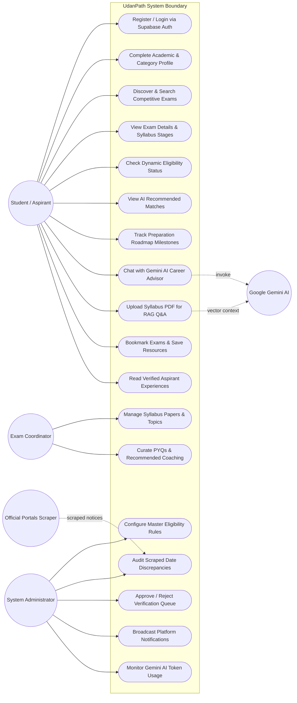

---

## 2. UML Class Diagram
### Category: UML Diagrams
### Purpose
Models the static structural architecture of the UdanPath platform, detailing domain entities, attributes with visibility and data types, operational methods, and object-oriented relationships (inheritance, aggregation, composition, and associations).

### Actors & Components
Core Domain Classes: StudentProfile, UserEducation, Exam, ExamPaper, ExamSubject, ExamTopic, ExamDate, EligibilityRule, EligibilityEngine, MatchmakingEngine, VerificationEngine, AiAdvisorService, RoadmapService.

### Flow & Technical Relationships
A StudentProfile holds multiple UserEducation records. An Exam is composed of multiple ExamPapers, which decompose into ExamSubjects and ExamTopics. EligibilityEngine evaluates StudentProfile against an Exam's EligibilityRules, producing an EligibilityResult consumed by MatchmakingEngine.

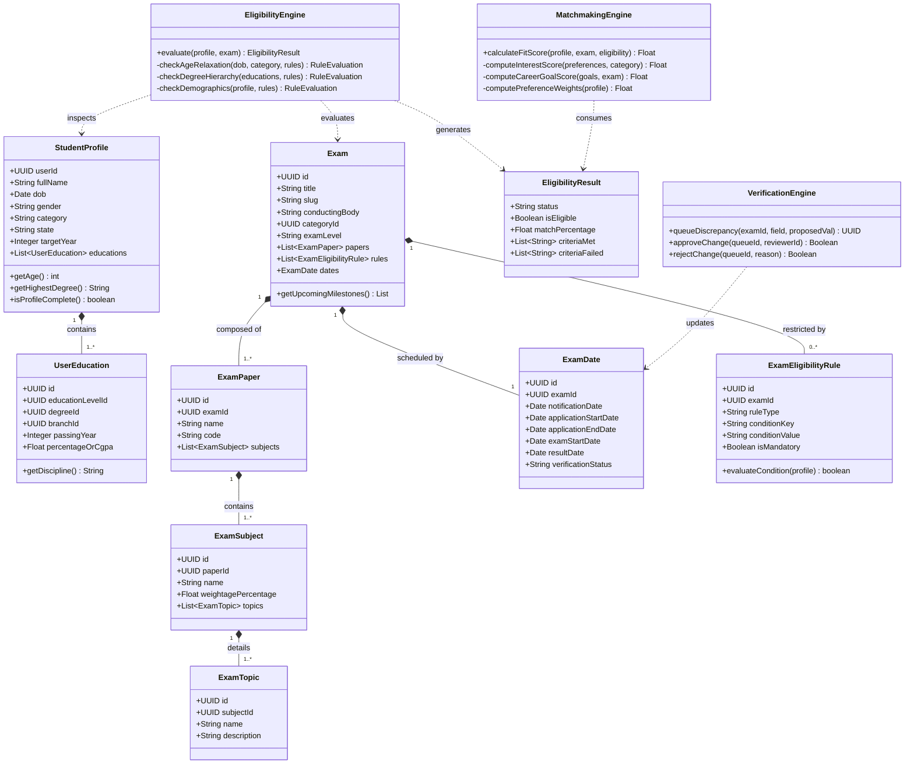

---

## 3. UML Activity Diagram
### Category: UML Diagrams
### Purpose
Illustrates the operational workflow and business logic of the student journey from onboarding and dynamic eligibility determination to AI recommendation ranking, roadmap progression, and study milestone tracking.

### Actors & Components
Student, Next.js Web Client, Eligibility Engine, Supabase Database, Gemini AI.

### Flow & Technical Relationships
Starts with user authentication -> profile inspection -> parallel fork for age relaxation and degree hierarchy evaluation -> join -> composite eligibility decision -> AI recommendation generation -> exam roadmap activation -> progress loop -> final exam readiness.

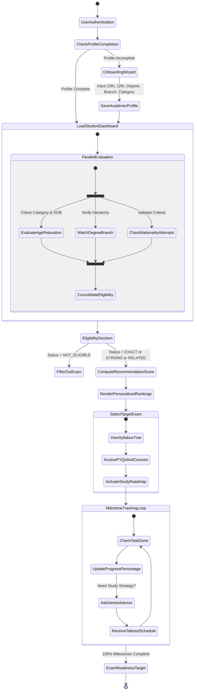

---

## 4. UML Sequence Diagram
### Category: UML Diagrams
### Purpose
Traces the chronological interaction and message interchange between the Student Client, Next.js Frontend Layer, API Routing Gateway, Eligibility Engine, Matchmaking Engine, Supabase Database, and Gemini AI during a personalized exam recommendation request.

### Actors & Components
Student, ClientUI (Next.js), APIRoute, EligibilityEngine, MatchmakingEngine, SupabaseDB (PostgreSQL), GeminiAI.

### Flow & Technical Relationships
Synchronous request to fetch exams -> Token verification -> DB queries for profile and exam master tables -> Rules evaluation loop -> Weighted score calculation -> Optional Gemini AI explanation stream -> Formatted JSON response delivered to UI.

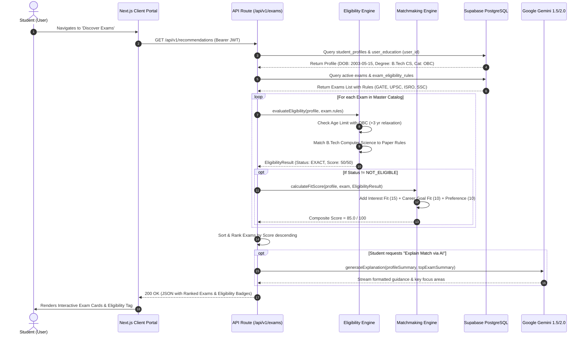

---

## 5. UML Communication Diagram
### Category: UML Diagrams
### Purpose
Emphasizes the structural organization and object collaborations of the UdanPath subsystem, displaying object link architecture with sequenced numeric messages for the real-time exam query workflow.

### Actors & Components
studentUI: ClientView, queryCtrl: ExamController, profService: ProfileService, ruleEngine: EligibilityEngine, examRepo: ExamRepository, auditLog: AuditLogger.

### Flow & Technical Relationships
Objects collaborate via explicit links. Numbers indicate sequence: 1: submitQuery(), 1.1: validateSession(), 2: fetchProfile(), 3: loadExamCatalog(), 4: evaluateRules(), 4.1: checkAge(), 4.2: matchDegrees(), 5: logQueryAudit(), 6: renderResults().

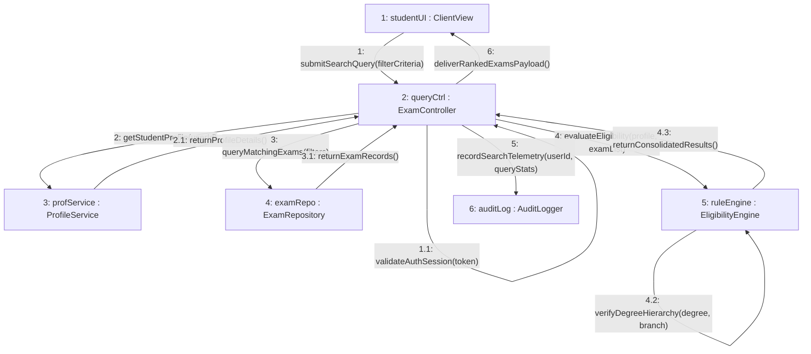

---

## 6. UML State Machine Diagram
### Category: UML Diagrams
### Purpose
Specifies the complete lifecycle states, events, guards, and transition logic for Exam Date Records and Scraped Official Notices as they transition from raw web ingestion to verified student publication.

### Actors & Components
Crawler Daemon, HTML Parser, Normalization Worker, Change Detector, System Admin, Notification Engine.

### Flow & Technical Relationships
Starts at UNINDEXED -> SCRAPED_COLLECTED -> PARSED_NORMALIZED -> EVALUATING_DIFF -> (If diff: PENDING_REVIEW in Verification Queue -> ADMIN_APPROVED -> PUBLISHED_ACTIVE; If no diff: REVERIFIED_UNCHANGED). Includes active exam calendar cycle states.

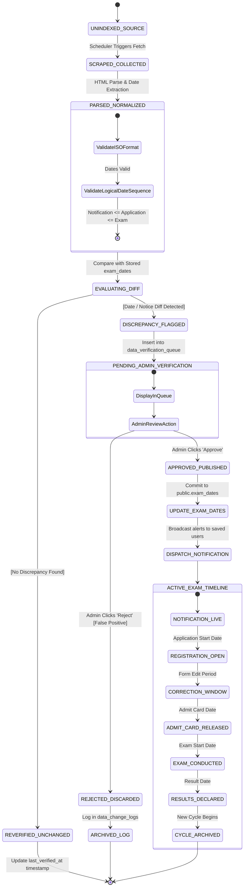

---

## 7. UML Component Diagram
### Category: UML Diagrams
### Purpose
Visualizes the structural modularity, software components, ports, and provided/required interfaces across the frontend client, backend application gateway, persistence layer, and external AI services.

### Actors & Components
Next.js Frontend, FastAPI Gateway, Supabase Cloud Platform, Google Gemini AI Engine, Official Govt Portals.

### Flow & Technical Relationships
Frontend components interact with Backend microservices via REST/WebSocket interfaces. Supabase provides Auth (GoTrue), Postgres (DB), and Storage. Backend invokes Gemini Pro API and drives scraper workers targeting official portals.

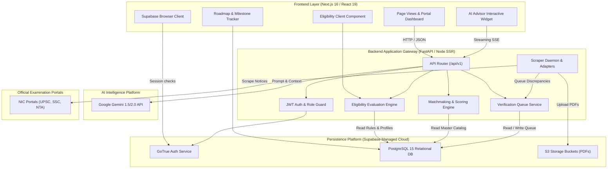

---

## 8. UML Deployment Diagram
### Category: UML Diagrams
### Purpose
Maps software artifacts to physical execution environments, hardware nodes, networking boundaries, communication protocols, and cloud hosting infrastructure.

### Actors & Components
Client Devices, Vercel Edge Network, Render Cloud Containers, Supabase Cloud Platform (AWS), Google Cloud Platform, NIC Servers.

### Flow & Technical Relationships
Users connect via HTTPS TLS 1.3 to Vercel CDN. Next.js handles SSR and static assets. API requests proxy to Render Container running FastAPI. Database queries communicate with Supabase AWS ap-southeast-1. Gemini AI runs on GCP.

```mermaid
graph TD
  subgraph Client_Device["Client Tier (User Devices)"]
    Browser["Modern Web Browser (Chrome, Safari, Firefox)<br/>Desktop & Mobile Viewport"]
  end

  subgraph Vercel_Platform["Vercel Cloud Platform (Edge & SSR)"]
    Edge_CDN["Global Anycast Edge CDN<br/>DDoS Mitigation & Caching"]
    Next_Server["Node.js 20 Serverless Runtime<br/>Next.js 16 SSR & App Router"]
  end

  subgraph Render_Platform["Container Cloud (Render / Cloud Run)"]
    Docker_Node["Docker Linux Container (Debian 12)<br/>FastAPI Gateway + Uvicorn<br/>Python 3.10 Runtime"]
    Worker_Node["Background Cron Worker<br/>Scraper Worker Daemon"]
  end

  subgraph Supabase_AWS["Supabase Managed Cloud (AWS ap-southeast-1)"]
    PG_DB["PostgreSQL 15 Cluster<br/>Row-Level Security & pgvector"]
    GoTrue_Auth["GoTrue Auth Microservice<br/>JWT & OAuth 2.0 Handler"]
    S3_Storage["MinIO / AWS S3 Compatible Storage<br/>Syllabus & PYQ Buckets"]
  end

  subgraph Google_Cloud["Google Cloud Platform (AI Infrastructure)"]
    Gemini_Endpoint["Google Gemini 1.5/2.0 Flash/Pro<br/>gRPC / HTTPS REST API"]
  end

  subgraph Govt_Servers["Official Govt Infrastructure"]
    NIC_Host["National Informatics Centre (NIC)<br/>Official UPSC / SSC / NTA Portals"]
  end

  %% Links with Protocols
  Browser -->|HTTPS / TLS 1.3 : Port 443| Edge_CDN
  Edge_CDN --> Next_Server
  Browser -->|Direct REST / JWT : Port 443| Docker_Node
  Browser -->|Direct Auth Session : Port 443| GoTrue_Auth

  Next_Server -->|Internal API Proxy| Docker_Node
  Docker_Node -->|TCP / SSL : Port 5432 / 6543 (PgBouncer)| PG_DB
  Docker_Node -->|REST API : Port 443| S3_Storage
  Docker_Node -->|REST HTTPS : Port 443| Gemini_Endpoint

  Worker_Node -->|HTTP GET Scrape : Port 443| NIC_Host
  Worker_Node -->|PostgreSQL DB Writes| PG_DB
```

---

## 9. UML Object Diagram
### Category: UML Diagrams
### Purpose
Exhibits a concrete runtime snapshot of specific instantiated objects, showing exact attribute values, data slots, and object relationship links for an active engineering aspirant.

### Actors & Components
user_ashish, profile_ashish, edu_btech, exam_gate2026, paper_cs, rule_age, rule_degree, eval_gate, rec_score.

### Flow & Technical Relationships
Runtime instance graph showing user 'Ashish Goswami' with B.Tech in Computer Science evaluating eligibility for GATE 2026, satisfying age criteria and degree requirements to achieve an EXACT eligibility match and score of 96.5.

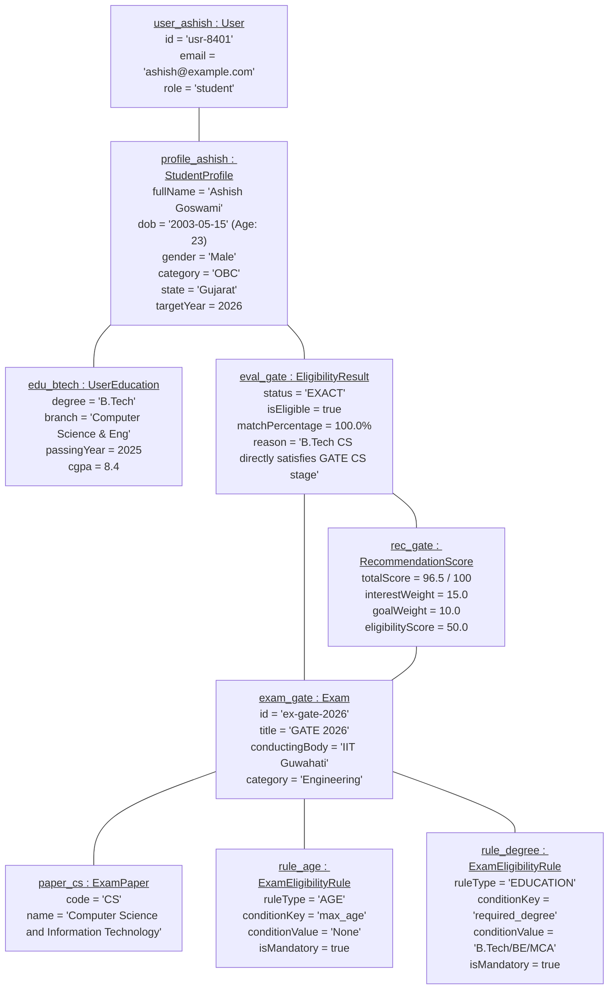

---

## 10. UML Package Diagram
### Category: UML Diagrams
### Purpose
Organizes the system into high-level logical namespaces, directories, and architectural packages, indicating cross-package compilation dependencies and layering constraints.

### Actors & Components
Presentation Package, Core Engines Package, Data Access Package, AI Integrations Package, Scraper Package, Domain Models Package.

### Flow & Technical Relationships
High-level Presentation Layer depends on Domain Engines and Data Access. Core Engines depend on Domain Models and Database Services. AI and Scraper packages encapsulate external API clients.

```mermaid
graph TD
  subgraph PresentationLayer["app::(portal) - Presentation Layer"]
    Pkg_Student["student::* (Aspirant Views)"]
    Pkg_Admin["admin::* (Admin Workspace)"]
    Pkg_Coord["exam-coordinator::* (Coordinator)"]
    Pkg_UI["components::ui (Shared UI Components)"]
  end

  subgraph CoreEngines["lib::engines - Domain Services"]
    Pkg_Elig["eligibilityEngine.ts"]
    Pkg_Match["matchmakingEngine.ts"]
    Pkg_Verify["verificationEngine.ts"]
    Pkg_Roadmap["roadmapService.ts"]
  end

  subgraph DataAccess["lib::data - Data Access Layer"]
    Pkg_SupaClient["supabaseClient.ts"]
    Pkg_SupaAdmin["supabaseAdmin.ts"]
    Pkg_DbService["dbService.ts / serverDbService.ts"]
  end

  subgraph AIIntegration["lib::ai - AI Services Layer"]
    Pkg_Gemini["geminiClient.ts"]
    Pkg_Rag["documentRagService.ts"]
  end

  subgraph Scrapers["backend::scrapers - Data Acquisition"]
    Pkg_Adapters["portalAdapters (UPSC/SSC/NTA)"]
    Pkg_Normalizer["dateNormalizer.py"]
  end

  subgraph DomainModels["types::domain - Type Declarations"]
    Pkg_TypesExam["exams.types.ts"]
    Pkg_TypesUser["profile.types.ts"]
    Pkg_TypesRules["eligibility.types.ts"]
  end

  %% Dependencies
  Pkg_Student ..> CoreEngines : <<import>>
  Pkg_Admin ..> CoreEngines : <<import>>
  Pkg_Coord ..> DataAccess : <<import>>
  Pkg_Student ..> AIIntegration : <<use>>

  CoreEngines ..> DataAccess : <<import>>
  CoreEngines ..> DomainModels : <<reference>>
  
  AIIntegration ..> DataAccess : <<read context>>
  Scrapers ..> DataAccess : <<write changes>>
```

---

## 11. UML Composite Structure Diagram
### Category: UML Diagrams
### Purpose
Shows the internal structure of the central classifier ExamIntelligenceEngine, displaying its internal parts, input/output ports, and inter-part collaboration connectors.

### Actors & Components
ExamIntelligenceEngine Classifier, DemographicParser, RuleHierarchyEvaluator, MatchWeightCalculator, RankingFilter, ContextSynthesizer.

### Flow & Technical Relationships
Requests enter through UserQueryPort, flow through Demographics and Rule Hierarchy parts, are weighted by MatchWeightCalculator, contextualized with AI, and delivered through RecommendationOutputPort.

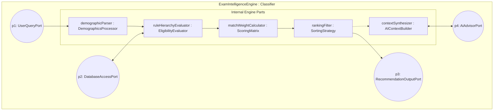

---

## 12. UML Timing Diagram
### Category: UML Diagrams
### Purpose
Captures the timing constraints and state transitions over an elapsed timeline (0 to 1200 milliseconds) for an end-to-end Student AI Advisor Query with RAG context synthesis.

### Actors & Components
UserClient, APIGateway, SupabaseDatabase, GeminiAIEndpoint.

### Flow & Technical Relationships
Visualizes state durations across lifelines: Client initiates request at 0ms; Gateway validates JWT (0-150ms); Database executes profile & syllabus queries (150-350ms); Gateway synthesizes prompt (350-450ms); Gemini generates tokens (450-1050ms); Client streams response to complete render at 1200ms.

```mermaid
gantt
  title UML Timing Diagram — Student AI Advisor Query Execution (0 to 1200 ms)
  dateFormat X
  axisFormat %s ms

  section UserClient
  IDLE                  :0, 50
  TRANSMITTING_QUERY    :50, 150
  WAITING_FIRST_TOKEN   :150, 600
  STREAMING_TOKENS      :600, 1150
  RENDER_COMPLETE       :1150, 1200

  section NextJS_APIGateway
  IDLE                  :0, 50
  VERIFY_JWT_SESSION    :50, 150
  FETCH_DB_CONTEXT      :150, 350
  SYNTHESIZE_PROMPT     :350, 450
  PIPE_SSE_STREAM       :450, 1150
  LOG_TRANSACTION       :1150, 1200

  section Supabase_Database
  IDLE                  :0, 150
  QUERY_USER_PROFILE    :150, 250
  QUERY_EXAM_SYLLABUS   :250, 350
  IDLE                  :350, 1150
  INSERT_CHAT_LOG       :1150, 1200

  section Gemini_AI_Engine
  IDLE                  :0, 450
  INFERENCE_PROCESSING  :450, 600
  STREAMING_CHUNKS      :600, 1150
  IDLE                  :1150, 1200
```

---

## 13. UML Interaction Overview Diagram
### Category: UML Diagrams
### Purpose
Provides a high-level architectural overview combining activity diagram decision flows with embedded sequence interaction occurrences for complete student engagement.

### Actors & Components
Student, AuthenticationFrame, OnboardingFrame, RecommendationFrame, ExplorationFrame, AIAdvisorFrame, RoadmapFrame.

### Flow & Technical Relationships
Start -> sd: UserLogin -> Decision: Profile Complete? -> (If No: sd: AcademicOnboarding) -> sd: ComputeRecommendations -> Fork: sd: ExploreExamDetails & sd: QueryGeminiAdvisor -> Join -> sd: ActivateRoadmap -> End.

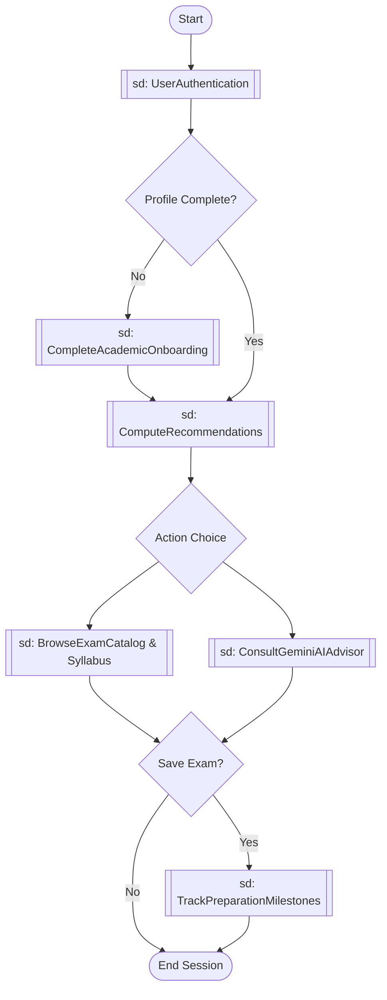

---

## 14. DFD Level 0 — Context Diagram
### Category: Data Flow Diagrams (DFD)
### Purpose
Establishes the boundary of the UdanPath system, treating it as a single central process communicating with external entities via primary input and output data flows.

### Actors & Components
External Entities: Student User, Administrator, Exam Coordinator, Supabase Auth, Supabase Storage, Google Gemini AI, Official Exam Portals (UPSC/SSC/NTA).

### Flow & Technical Relationships
Students provide credentials and profile choices; receive eligibility statuses, recommendations, roadmaps, and AI guidance. Admins provide verification actions; receive discrepancy queues. Gemini receives prompts; returns analysis. Portals supply scraped notices.

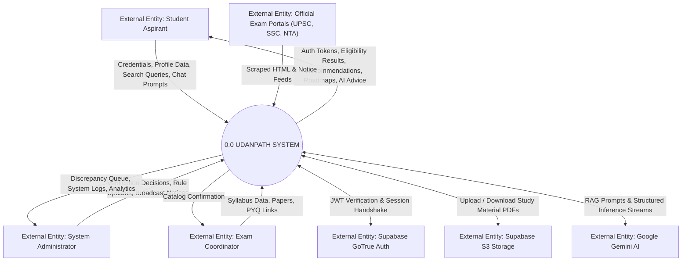

---

## 15. DFD Level 1 — System Decomposition
### Category: Data Flow Diagrams (DFD)
### Purpose
Decomposes the Level 0 context bubble into the 12 primary functional processes and reveals the 11 persistent data stores accessed across transactions.

### Actors & Components
Processes 1.0 to 12.0; Data Stores D1 to D11; External Entities.

### Flow & Technical Relationships
P1 (Auth), P2 (Profile), P3 (Discovery), P4 (Eligibility), P5 (Recommendations), P6 (Scraper), P7 (Resources), P8 (Roadmaps), P9 (AI Advisor), P10 (PDF RAG), P11 (Notifications), P12 (Verification Queue).

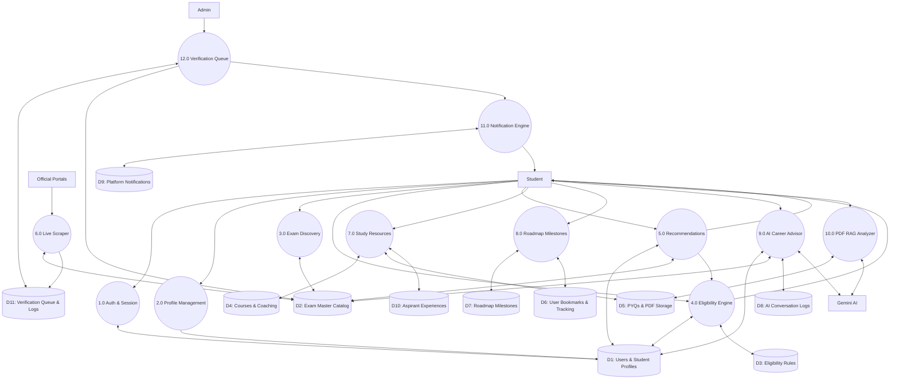

---

## 16. DFD Level 2 — Process 1.0 (Auth & Session Management)
### Category: Data Flow Diagrams (DFD)
### Purpose
Breaks down Process 1.0 into granular subprocesses covering credential submission, GoTrue token verification, role resolution, and session state maintenance.

### Actors & Components
Student, Admin, GoTrue Service, D1 (Users & Profiles).

### Flow & Technical Relationships
1.1 Receive Credentials -> 1.2 Verify JWT / OAuth -> 1.3 Resolve Role (Student/Admin/Coordinator) -> 1.4 Cache Session Context.

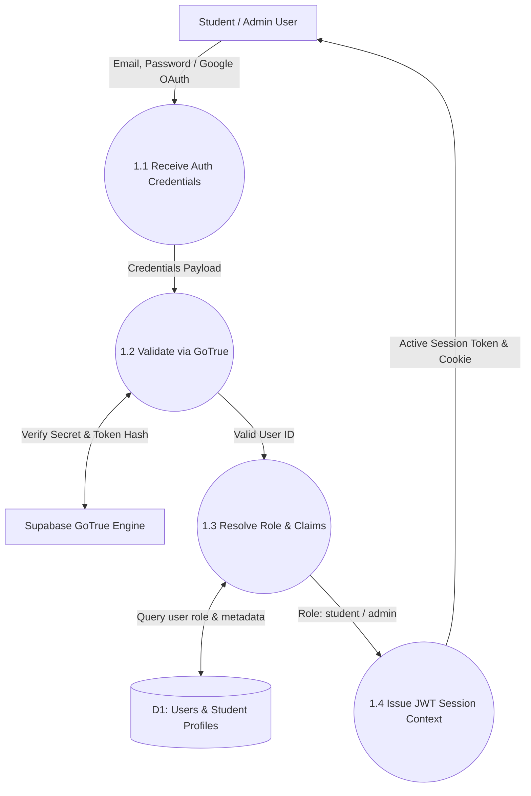

---

## 17. DFD Level 2 — Process 2.0 (Student Profile & Preferences)
### Category: Data Flow Diagrams (DFD)
### Purpose
Details the data transformations when a student completes academic onboarding, specifies categories and state, and configures target preferences.

### Actors & Components
Student User, D1 (Users & Profiles), D3 (Master Degrees/Branches).

### Flow & Technical Relationships
2.1 Collect Academic History -> 2.2 Validate Degree/Branch IDs -> 2.3 Store Demographics -> 2.4 Set Career Goals & Preferences.

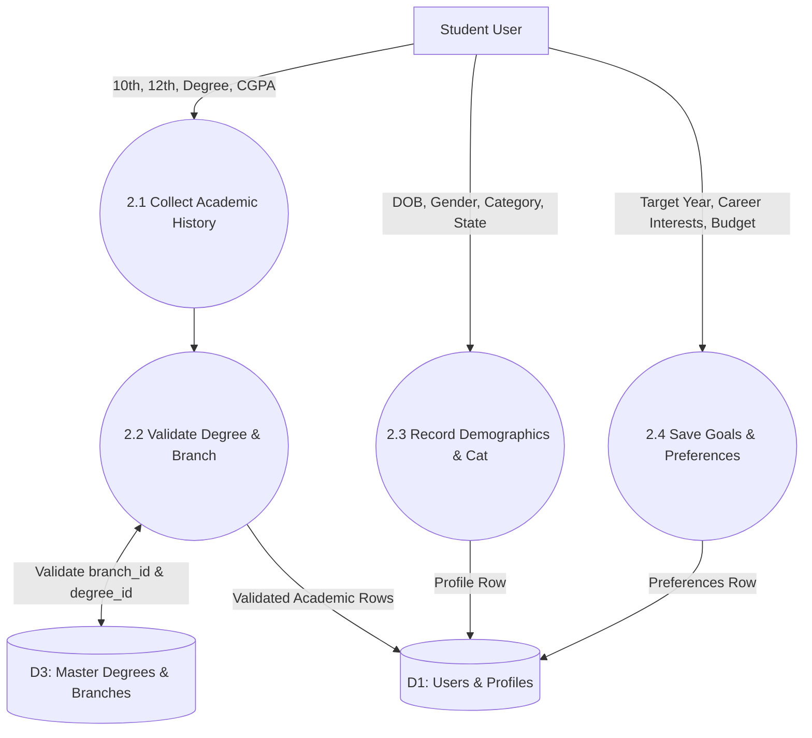

---

## 18. DFD Level 2 — Process 3.0 (Exam Discovery & Catalog)
### Category: Data Flow Diagrams (DFD)
### Purpose
Models the detailed data transformations during exam searching, filtering by conducting body or level, syllabus consolidation, and bookmark toggling.

### Actors & Components
Student, D2 (Exams Catalog), D4 (Courses), D5 (PYQs), D6 (Bookmarks).

### Flow & Technical Relationships
3.1 Parse Search Filters -> 3.2 Query Catalog -> 3.3 Consolidate Syllabus Stages -> 3.4 Fetch Associated Study Materials -> 3.5 Toggle Bookmark.

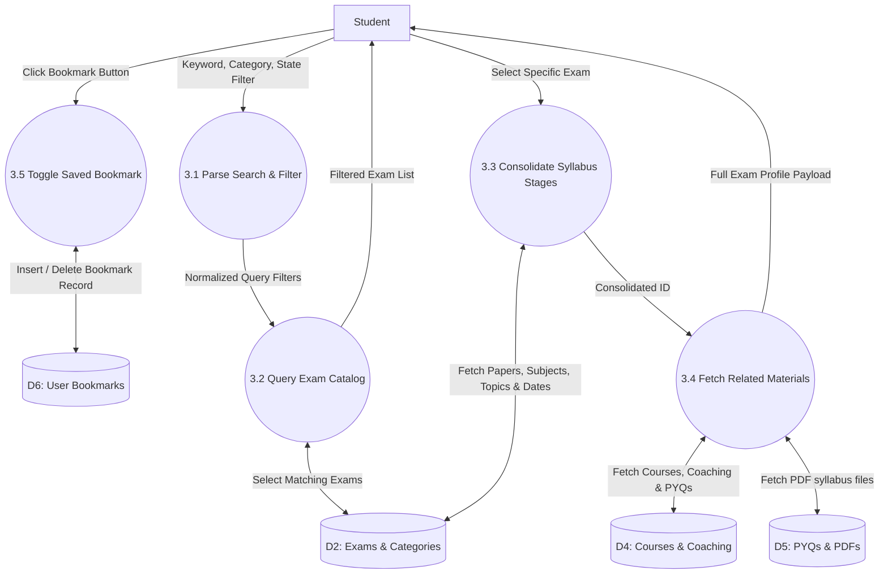

---

## 19. DFD Level 2 — Process 4.0 (Dynamic Eligibility Engine)
### Category: Data Flow Diagrams (DFD)
### Purpose
Details the multi-stage eligibility evaluation process matching student demographics, age limits with reservation relaxations, degree branch hierarchies, and nationality/attempts.

### Actors & Components
Student, D1 (Profiles DB), D3 (Eligibility Rules DB).

### Flow & Technical Relationships
4.1 Fetch Profile -> 4.2 Fetch Exam Rules -> 4.3 Evaluate Age Relaxation -> 4.4 Evaluate Degree & Branch Hierarchy -> 4.5 Validate Demographics -> 4.6 Consolidate Result Status.

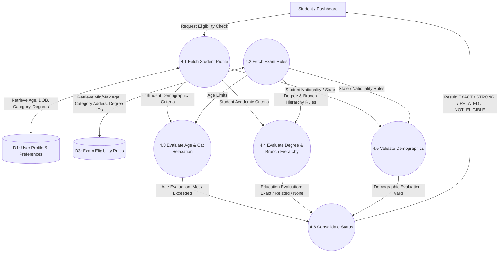

---

## 20. DFD Level 2 — Process 5.0 (Recommendation Engine)
### Category: Data Flow Diagrams (DFD)
### Purpose
Specifies the weighted recommendation algorithm that filters out ineligible exams and scores eligible ones across interest alignment, career goals, and student preferences.

### Actors & Components
Student, D1 (Profiles), D2 (Exams Catalog), Process 4.0.

### Flow & Technical Relationships
5.1 Retrieve Profile -> 5.2 Filter Ineligible -> 5.3 Compute Interest Score -> 5.4 Compute Career Goal Score -> 5.5 Compute Preference Score -> 5.6 Calculate Weighted Total -> 5.7 Sort & Rank.

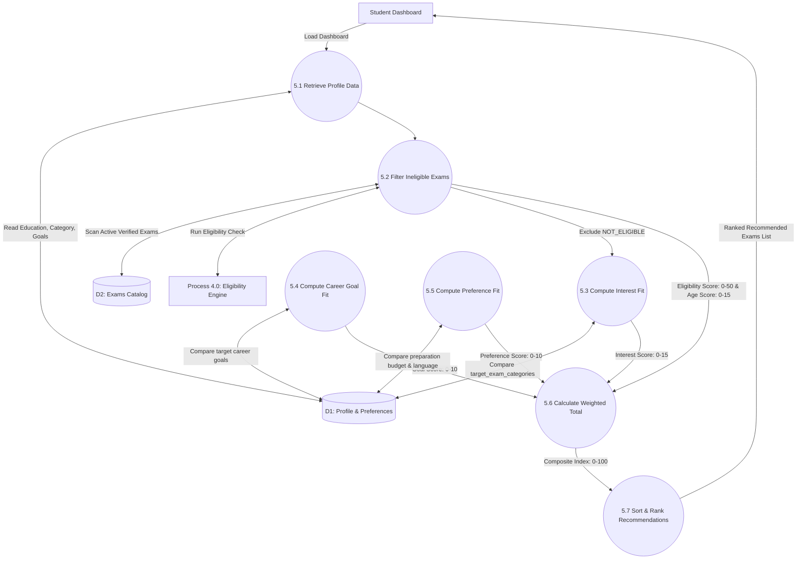

---

## 21. DFD Level 2 — Process 6.0 (Live Scraper & Exam Data)
### Category: Data Flow Diagrams (DFD)
### Purpose
Maps the automated web scraping, notice parsing, ISO date normalization, change detection, and queue dispatching for live official exam updates.

### Actors & Components
Official Portals, D2 (Exams & Dates DB), D11 (Verification Queue & Logs), Admin.

### Flow & Technical Relationships
6.1 Scheduler Trigger -> 6.2 Scrape Portal HTML -> 6.3 Extract & Normalize Dates -> 6.4 Validate Logical Integrity -> 6.5 Change Detection -> 6.6 Direct Commit / 6.7 Push to Queue -> 6.8 Admin Review.

```mermaid
graph TD
  Official["Official Portals (UPSC/SSC)"]
  Admin["System Administrator"]
  D2[("D2: Exams & Dates DB")]
  D11[("D11: Verification Queue & Logs")]

  P6_1((6.1 Scheduler Trigger))
  P6_2((6.2 Scrape Portal HTML))
  P6_3((6.3 Extract & Normalize Dates))
  P6_4((6.4 Validate Logical Integrity))
  P6_5((6.5 Change Detection vs Stored))
  P6_6((6.6 Direct Status Update))
  P6_7((6.7 Push Discrepancy to Queue))
  P6_8((6.8 Process Admin Review))

  P6_1 -.->|Hourly Cron| P6_2
  P6_2 <-->|HTTP GET target notice URLs| Official
  P6_2 -->|Raw HTML Payload| P6_3
  P6_3 -->|Parsed Standard Dates JSON| P6_4
  P6_4 -->|Validated Date Entities| P6_5

  P6_5 <-->|Read Current Stored Dates| D2

  P6_5 -->|Dates Identical: No Discrepancy| P6_6
  P6_6 -->|Update last_verified_at = now()| D2

  P6_5 -->|Date Difference Detected| P6_7
  P6_7 -->|Insert Pending Review Item| D11

  Admin -->|Approve / Reject Action| P6_8
  P6_8 <-->|Read Pending Queue| D11
  P6_8 -->|Approved: Update exam_dates| D2
```

---

## 22. DFD Level 2 — Process 7.0 (Study Resources & PYQs Hub)
### Category: Data Flow Diagrams (DFD)
### Purpose
Details how students query past examination questions, online video links, coaching recommendations, and peer aspirant experiences.

### Actors & Components
Student, D4 (Courses/Coaching), D5 (PYQs/PDFs), D10 (Aspirant Experiences).

### Flow & Technical Relationships
7.1 Query PYQs by Year -> 7.2 Fetch Online Courses -> 7.3 Retrieve YouTube Playlists -> 7.4 Load Aspirant Experiences.

```mermaid
graph TD
  Student["Student User"]
  D4[("D4: Courses & Coaching")]
  D5[("D5: PYQs & Storage")]
  D10[("D10: Aspirant Experiences")]

  P7_1((7.1 Query PYQs by Year & Stage))
  P7_2((7.2 Fetch Online Courses & Fees))
  P7_3((7.3 Retrieve YouTube Resources))
  P7_4((7.4 Load Verified Experiences))

  Student -->|Select Exam & Subject| P7_1
  P7_1 <-->|Filter Questions & PDF Links| D5
  P7_1 -->|PYQ Paper Sets & Answers| Student

  Student -->|Browse Coaching| P7_2
  P7_2 <-->|Query Providers, Language, Rating| D4
  P7_2 -->|Verified Coaching Cards| Student

  Student -->|View Video Playlists| P7_3
  P7_3 <-->|Select Curated YouTube Links| D4
  P7_3 -->|Free Lecture Links| Student

  Student -->|Read Topper Stories| P7_4
  P7_4 <-->|Fetch Stories & Tips| D10
  P7_4 -->|Aspirant Advice Feed| Student
```

---

## 23. DFD Level 2 — Process 8.0 (Roadmap & Milestone Tracking)
### Category: Data Flow Diagrams (DFD)
### Purpose
Documents the generation of preparation timelines, division of syllabus into tiered phases, and tracking of individual study tasks.

### Actors & Components
Student, D6 (Bookmarks & Progress), D7 (Roadmap Milestones DB).

### Flow & Technical Relationships
8.1 Resolve Target Year -> 8.2 Load Milestone Tiers -> 8.3 Generate Phased Schedule -> 8.4 Track Task Checkboxes -> 8.5 Compute Progress Percentages.

```mermaid
graph TD
  Student["Student User"]
  D6[("D6: User Progress & Tracking")]
  D7[("D7: Roadmap Milestones")]

  P8_1((8.1 Resolve Target Exam & Year))
  P8_2((8.2 Load Milestone Tiers))
  P8_3((8.3 Generate Phased Schedule))
  P8_4((8.4 Track Task Checkboxes))
  P8_5((8.5 Compute Completion Score))

  Student -->|Enroll in Exam Roadmap| P8_1
  P8_1 --> P8_2
  P8_2 <-->|Fetch Phase 1 Foundation, Phase 2 Core, Phase 3 Revision| D7
  P8_2 --> P8_3
  P8_3 -->|Render Milestone Cards| Student

  Student -->|Check Off Syllabus Task| P8_4
  P8_4 <-->|Toggle is_completed = true/false| D6
  P8_4 --> P8_5
  P8_5 <-->|Calculate Completed vs Total Tasks| D6
  P8_5 -->|Progress: 68% Ready| Student
```

---

## 24. DFD Level 2 — Process 9.0 (AI Career Advisor)
### Category: Data Flow Diagrams (DFD)
### Purpose
Specifies the conversational AI flow: enriching prompts with student demographics and exam criteria, querying Gemini 1.5/2.0, streaming responses, and recording logs.

### Actors & Components
Student, Gemini AI, D1 (Profiles), D2 (Exams), D8 (Chat Logs).

### Flow & Technical Relationships
9.1 Authenticate Request -> 9.2 Retrieve Profile & Exam Context -> 9.3 Retrieve Chat History -> 9.4 Build Prompt & Query Gemini -> 9.5 Validate Stream -> 9.6 Save Logs.

```mermaid
graph TD
  Student["Student User (Chat UI)"]
  Gemini["Google Gemini 1.5/2.0 API"]
  D1[("D1: User Profiles")]
  D2[("D2: Exams DB")]
  D8[("D8: Chat Conversation Logs")]

  P9_1((9.1 Authenticate Request))
  P9_2((9.2 Fetch Profile & Exam Context))
  P9_3((9.3 Fetch Recent Chat History))
  P9_4((9.4 Synthesize Prompt & Call Gemini))
  P9_5((9.5 Validate & Stream Reply))
  P9_6((9.6 Save Conversation Log))

  Student -->|User Message + Target Exam ID| P9_1
  P9_1 <-->|Verify User ID| D1
  P9_1 --> P9_2
  
  P9_2 <-->|Read Education & Demographics| D1
  P9_2 <-->|Read Exam Syllabus & Deadlines| D2
  P9_2 --> P9_4

  P9_3 <-->|Read Last 10 Messages| D8
  P9_3 --> P9_4

  P9_4 <-->|Stream Prompt with Context| Gemini
  P9_4 -->|SSE Stream Chunks| P9_5
  P9_5 -->|Real-time Token Stream| Student
  P9_5 -->|Final Completed Response| P9_6
  P9_6 -->|Insert Message Row| D8
```

---

## 25. DFD Level 2 — Process 10.0 (PDF/RAG Processing)
### Category: Data Flow Diagrams (DFD)
### Purpose
Models document handling: uploading official syllabus PDFs, text extraction, chunking, vector contextualization, and user document Q&A.

### Actors & Components
Student, Gemini AI, D5 (Storage), D8 (Chat Logs).

### Flow & Technical Relationships
10.1 Validate & Store PDF -> 10.2 Extract Clean Text -> 10.3 Chunk Document -> 10.4 Index Chunks -> 10.5 Retrieve Passages -> 10.6 Run Contextual QA with Gemini.

```mermaid
graph TD
  Student["Student"]
  Gemini["Google Gemini AI"]
  D5[("D5: Supabase Storage (PDFs)")]
  D8[("D8: Document Analysis Logs")]

  P10_1((10.1 Validate & Store PDF))
  P10_2((10.2 Extract Clean Text))
  P10_3((10.3 Chunk into Logical Sections))
  P10_4((10.4 Index Chunks / Vector Context))
  P10_5((10.5 Retrieve Relevant Chunks))
  P10_6((10.6 Run Contextual QA))

  Student -->|Uploads Syllabus / Notice PDF| P10_1
  P10_1 <-->|Save Raw PDF File| D5
  P10_1 -->|Binary PDF Stream| P10_2
  P10_2 -->|Clean Text Stream| P10_3
  P10_3 -->|Document Segments| P10_4
  P10_4 <-->|Cache Document Summary| D8

  Student -->|Ask Question About Document| P10_5
  P10_5 <-->|Fetch Matching Chunks| D8
  P10_5 -->|Question + Document Chunks| P10_6
  P10_6 <-->|Inference Analysis| Gemini
  P10_6 -->|Grounded Answer with Citations| Student
```

---

## 26. Entity Relationship Diagram (ERD)
### Category: Database Models
### Purpose
Provides the complete Crow's Foot Entity Relationship Diagram connecting all 25 tables of the UdanPath database, reflecting exact primary keys, foreign keys, and cardinalities.

### Actors & Components
Database Tables: users, student_profiles, user_education, master_degrees, master_branches, exams, exam_categories, exam_dates, exam_sources, exam_papers, exam_subjects, exam_topics, exam_eligibility_rules, exam_pyqs, exam_courses, user_bookmarks, exam_milestones, user_study_progress, data_verification_queue, user_notifications, ai_interaction_logs.

### Flow & Technical Relationships
Users link to profiles and bookmarks. Master education tables normalize degree/branch hierarchies. Exams link to categories, dates, papers, syllabus trees, eligibility rules, and verification items.

```mermaid
erDiagram
    users ||--o| student_profiles : "has"
    users ||--o| user_preferences : "configures"
    users ||--o{ user_education : "completes"
    users ||--o{ user_bookmarks : "saves"
    users ||--o{ user_notifications : "receives"
    users ||--o{ ai_interaction_logs : "interacts"

    master_education_levels ||--o{ master_degrees : "contains"
    master_degrees ||--o{ master_branches : "contains"
    user_education }o--|| master_education_levels : "references"
    user_education }o--|| master_degrees : "references"
    user_education }o--|| master_branches : "references"

    exams }o--|| exam_categories : "classified_by"
    exams ||--o| exam_dates : "scheduled_in"
    exams ||--o{ exam_papers : "stages"
    exams ||--o{ exam_eligibility_rules : "restricted_by"
    exams ||--o{ exam_milestones : "split_into"
    exams ||--o{ user_bookmarks : "saved_in"

    exam_dates }o--|| exam_sources : "obtained_from"
    exam_papers ||--o{ exam_subjects : "outlines"
    exam_subjects ||--o{ exam_topics : "details"

    user_study_progress }o--|| exams : "references"
    user_study_progress }o--|| exam_topics : "tracks"
    user_study_progress }o--|| users : "belongs_to"

    data_verification_queue }o--|| exams : "triggers_for"
    data_verification_queue }o--|| exam_sources : "fetched_by"

    users {
        uuid id PK
        varchar email
        varchar role
        timestamptz created_at
    }

    student_profiles {
        uuid id PK
        uuid user_id FK
        varchar full_name
        date dob
        varchar gender
        varchar category
        varchar state
        int target_year
    }

    user_education {
        uuid id PK
        uuid user_id FK
        uuid education_level_id FK
        uuid degree_id FK
        uuid branch_id FK
        int passing_year
        numeric percentage_or_cgpa
    }

    exams {
        uuid id PK
        varchar title
        varchar slug
        uuid category_id FK
        varchar conducting_body
        varchar exam_level
    }

    exam_dates {
        uuid id PK
        uuid exam_id FK
        date notification_release_date
        date application_start_date
        date application_end_date
        date exam_start_date
        date result_date
        varchar verification_status
    }

    exam_eligibility_rules {
        uuid id PK
        uuid exam_id FK
        varchar rule_type
        varchar condition_key
        text condition_value
        boolean is_mandatory
    }

    data_verification_queue {
        uuid id PK
        uuid exam_id FK
        uuid source_id FK
        varchar field_name
        text proposed_value
        varchar status
    }
```

---

## 27. Conceptual Data Model
### Category: Database Models
### Purpose
Outlines high-level enterprise business entities and semantic associations without implementation-specific technical attributes, accessible to both stakeholders and engineers.

### Actors & Components
Student Aspirant, Academic Credential, Competitive Exam, Stage/Paper, Syllabus Subject/Topic, Eligibility Rule, Preparation Roadmap, Study Asset, Verification Record.

### Flow & Technical Relationships
A Student Aspirant holds Academic Credentials, qualifies for Competitive Exams based on Eligibility Rules, follows Preparation Roadmaps, accesses Study Assets, while Official Notices generate Verification Records.

```mermaid
graph TD
  Student["Student Aspirant<br/>(Demographics, Reservation, Year)"]
  Credential["Academic Credential<br/>(Level, Degree, Branch, CGPA)"]
  Exam["Competitive Exam<br/>(Body, Tier, Level, Category)"]
  Stage["Stage / Exam Paper<br/>(Prelims, Mains, Technical)"]
  Syllabus["Syllabus Tree<br/>(Subjects, Modules, Topics)"]
  Rule["Eligibility Rule<br/>(Age, Degree, Attempts)"]
  Roadmap["Preparation Roadmap<br/>(Phases, Milestones, Tasks)"]
  StudyAsset["Study Asset<br/>(PYQs, Online Courses, PDFs)"]
  Verification["Verification Record<br/>(Scraped Notice, Status)"]

  Student -- "earned" --> Credential
  Student -- "targets" --> Exam
  Student -- "monitors progress in" --> Roadmap

  Exam -- "subdivided into" --> Stage
  Stage -- "covers" --> Syllabus
  Exam -- "governed by" --> Rule
  Exam -- "offers" --> Roadmap
  Exam -- "supported by" --> StudyAsset
  Exam -- "validated through" --> Verification
```

---

## 28. Logical Data Model (LDM)
### Category: Database Models
### Purpose
Defines normalized third-normal-form (3NF) relational structures, primary key attributes, alternate keys, foreign key constraints, and relational domain data types.

### Actors & Components
Normalized entities: USER, STUDENT_PROFILE, USER_EDUCATION, MASTER_DEGREE, MASTER_BRANCH, EXAM, EXAM_DATE, EXAM_PAPER, EXAM_ELIGIBILITY_RULE, BOOKMARK.

### Flow & Technical Relationships
Shows formal entity-relationship constraints independent of database engine vendor features, ensuring referential integrity and zero transitive dependencies.

```mermaid
erDiagram
    USER ||--|| STUDENT_PROFILE : identifies
    USER ||--o{ USER_EDUCATION : attains
    USER ||--o{ USER_BOOKMARK : stores
    USER ||--o{ STUDY_PROGRESS : tracks

    MASTER_DEGREE ||--o{ MASTER_BRANCH : classifies
    USER_EDUCATION }o--|| MASTER_DEGREE : qualifies_with
    USER_EDUCATION }o--|| MASTER_BRANCH : specializes_in

    EXAM_CATEGORY ||--o{ EXAM : groups
    EXAM ||--|| EXAM_DATE : scheduled_as
    EXAM ||--o{ EXAM_PAPER : comprises
    EXAM ||--o{ EXAM_ELIGIBILITY_RULE : dictates
    EXAM ||--o{ EXAM_MILESTONE : schedules
    EXAM ||--o{ USER_BOOKMARK : bookmarked_by

    EXAM_PAPER ||--o{ EXAM_SUBJECT : divides_into
    EXAM_SUBJECT ||--o{ EXAM_TOPIC : details

    STUDY_PROGRESS }o--|| EXAM_TOPIC : completes

    USER {
        UUID user_id PK
        VARCHAR email UK
        VARCHAR role_name
    }
    STUDENT_PROFILE {
        UUID profile_id PK
        UUID user_id FK
        VARCHAR full_name
        DATE date_of_birth
        VARCHAR category_code
    }
    EXAM {
        UUID exam_id PK
        VARCHAR exam_slug UK
        VARCHAR exam_title
        UUID category_id FK
    }
    EXAM_DATE {
        UUID date_id PK
        UUID exam_id FK
        DATE app_start_date
        DATE app_end_date
        DATE exam_start_date
    }
    EXAM_ELIGIBILITY_RULE {
        UUID rule_id PK
        UUID exam_id FK
        VARCHAR rule_type
        VARCHAR condition_key
        VARCHAR condition_value
    }
```

---

## 29. Physical Data Model (PDM)
### Category: Database Models
### Purpose
Details physical storage structures for Supabase PostgreSQL 15, including exact column data types, DEFAULT gen_random_uuid(), indexes, ON DELETE CASCADE foreign keys, and RLS policies.

### Actors & Components
Physical Tables: users, student_profiles, exams, exam_dates, exam_eligibility_rules, data_verification_queue, user_study_progress.

### Flow & Technical Relationships
Includes PostgreSQL physical constructs: UUID primary keys, B-Tree indexes on slugs and user IDs, JSONB task structures, and RLS policy boundaries.

```mermaid
erDiagram
    public_users ||--o| public_student_profiles : "CASCADE"
    public_exams ||--o| public_exam_dates : "CASCADE"
    public_exams ||--o{ public_exam_papers : "CASCADE"
    public_exams ||--o{ public_exam_eligibility_rules : "CASCADE"
    public_exams ||--o{ public_data_verification_queue : "CASCADE"

    public_users {
        UUID id PK "DEFAULT gen_random_uuid()"
        VARCHAR_255 email "NOT NULL UNIQUE"
        VARCHAR_50 role "DEFAULT 'student'"
        TIMESTAMPTZ created_at "DEFAULT now()"
    }

    public_student_profiles {
        UUID id PK "DEFAULT gen_random_uuid()"
        UUID user_id FK "REFERENCES public_users(id) ON DELETE CASCADE"
        VARCHAR_255 full_name "NOT NULL"
        DATE dob "NOT NULL"
        VARCHAR_50 category "NOT NULL"
        VARCHAR_100 state "NOT NULL"
        INT target_year "DEFAULT 2026"
    }

    public_exams {
        UUID id PK "DEFAULT gen_random_uuid()"
        VARCHAR_255 title "NOT NULL"
        VARCHAR_255 slug "NOT NULL UNIQUE INDEX idx_exams_slug"
        VARCHAR_255 conducting_body "NOT NULL"
        TIMESTAMPTZ created_at "DEFAULT now()"
    }

    public_exam_dates {
        UUID id PK "DEFAULT gen_random_uuid()"
        UUID exam_id FK "REFERENCES public_exams(id) ON DELETE CASCADE"
        DATE application_start_date "NULLABLE"
        DATE application_end_date "NULLABLE"
        DATE exam_start_date "NULLABLE"
        VARCHAR_50 verification_status "DEFAULT 'PENDING_REVIEW'"
    }

    public_exam_eligibility_rules {
        UUID id PK "DEFAULT gen_random_uuid()"
        UUID exam_id FK "REFERENCES public_exams(id) ON DELETE CASCADE"
        VARCHAR_50 rule_type "NOT NULL"
        VARCHAR_100 condition_key "NOT NULL"
        TEXT condition_value "NOT NULL"
        BOOLEAN is_mandatory "DEFAULT true"
    }

    public_data_verification_queue {
        UUID id PK "DEFAULT gen_random_uuid()"
        UUID exam_id FK "REFERENCES public_exams(id) ON DELETE CASCADE"
        VARCHAR_100 field_name "NOT NULL"
        TEXT proposed_value "NOT NULL"
        VARCHAR_50 status "DEFAULT 'PENDING'"
        UUID reviewed_by FK "REFERENCES public_users(id) ON DELETE SET NULL"
    }
```

---

## 30. Database Schema Diagram
### Category: Database Models
### Purpose
Architectural clustering of database tables into 7 distinct functional schemas/subdomains within PostgreSQL, showing inter-schema relationships and data boundaries.

### Actors & Components
Schemas: auth_schema, profile_schema, exam_catalog_schema, syllabus_schema, eligibility_schema, progress_schema, verification_schema.

### Flow & Technical Relationships
Organizes tables into isolated functional clusters: Auth manages tokens; Profile manages educational records; Catalog manages core exam metadata; Syllabus manages stage hierarchies; Eligibility evaluates rules; Progress manages roadmaps; Verification audits scraped dates.

```mermaid
graph TD
  subgraph Auth_Domain["1. Auth & Security Schema"]
    tbl_users["users<br/>(id, email, role, created_at)"]
  end

  subgraph Profile_Domain["2. Student Academic Profile Schema"]
    tbl_profiles["student_profiles<br/>(id, user_id, full_name, dob, category, state)"]
    tbl_education["user_education<br/>(id, user_id, degree_id, branch_id, cgpa)"]
    tbl_prefs["user_preferences<br/>(id, user_id, goals, budget)"]
    tbl_m_degrees["master_degrees"]
    tbl_m_branches["master_branches"]
  end

  subgraph Catalog_Domain["3. Exam Catalog Schema"]
    tbl_exams["exams<br/>(id, title, slug, body, level)"]
    tbl_categories["exam_categories<br/>(id, name, code)"]
    tbl_dates["exam_dates<br/>(id, exam_id, start_date, end_date)"]
    tbl_sources["exam_sources<br/>(id, name, base_url, type)"]
  end

  subgraph Syllabus_Domain["4. Syllabus Hierarchy Schema"]
    tbl_papers["exam_papers<br/>(id, exam_id, name, code)"]
    tbl_subjects["exam_subjects<br/>(id, paper_id, name, weightage)"]
    tbl_topics["exam_topics<br/>(id, subject_id, name, desc)"]
  end

  subgraph Eligibility_Domain["5. Dynamic Eligibility Schema"]
    tbl_rules["exam_eligibility_rules<br/>(id, exam_id, rule_type, condition_key, condition_val)"]
  end

  subgraph Progress_Domain["6. Prep Progress & Roadmaps Schema"]
    tbl_milestones["exam_milestones<br/>(id, exam_id, tier, tasks_json)"]
    tbl_progress["user_study_progress<br/>(id, user_id, topic_id, completed)"]
    tbl_bookmarks["user_bookmarks<br/>(id, user_id, exam_id)"]
  end

  subgraph Audit_Domain["7. Scraping & Verification Schema"]
    tbl_queue["data_verification_queue<br/>(id, exam_id, proposed_val, status)"]
    tbl_changelogs["data_change_logs<br/>(id, exam_id, old_val, new_val)"]
  end

  %% Inter-Schema Foreign Keys
  tbl_users --> tbl_profiles
  tbl_users --> tbl_education
  tbl_profiles --> tbl_prefs
  tbl_education --> tbl_m_degrees
  tbl_education --> tbl_m_branches

  tbl_exams --> tbl_categories
  tbl_exams --> tbl_dates
  tbl_dates --> tbl_sources

  tbl_exams --> tbl_papers
  tbl_papers --> tbl_subjects
  tbl_subjects --> tbl_topics

  tbl_exams --> tbl_rules
  tbl_exams --> tbl_milestones
  tbl_users --> tbl_progress
  tbl_topics --> tbl_progress
  tbl_users --> tbl_bookmarks
  tbl_exams --> tbl_bookmarks

  tbl_exams --> tbl_queue
  tbl_exams --> tbl_changelogs
```

---

## 31. Relational Table Diagram (PK/FK Constraints)
### Category: Database Models
### Purpose
Comprehensive visual matrix detailing every relational table, its Primary Key (PK), Foreign Keys (FK with target table.column), NOT NULL constraints, and relationship types.

### Actors & Components
Relational Tables: users, student_profiles, exams, exam_dates, exam_papers, exam_eligibility_rules, user_bookmarks, data_verification_queue.

### Flow & Technical Relationships
Presents structured tabular schema definitions with foreign key constraints, cascade rules, unique indexes, and default column values.

```mermaid
graph LR
  subgraph TBL_USERS["public.users"]
    U_PK["PK id : UUID"]
    U_EMAIL["email : VARCHAR(255) [UQ, NN]"]
    U_ROLE["role : VARCHAR(50) [NN]"]
  end

  subgraph TBL_PROFILES["public.student_profiles"]
    P_PK["PK id : UUID"]
    P_FK["FK user_id -> users.id [NN, ON DELETE CASCADE]"]
    P_NAME["full_name : VARCHAR(255) [NN]"]
    P_DOB["dob : DATE [NN]"]
    P_CAT["category : VARCHAR(50) [NN]"]
  end

  subgraph TBL_EXAMS["public.exams"]
    E_PK["PK id : UUID"]
    E_SLUG["slug : VARCHAR(255) [UQ, NN]"]
    E_TITLE["title : VARCHAR(255) [NN]"]
    E_BODY["conducting_body : VARCHAR(255)"]
  end

  subgraph TBL_DATES["public.exam_dates"]
    D_PK["PK id : UUID"]
    D_FK["FK exam_id -> exams.id [NN, ON DELETE CASCADE]"]
    D_START["application_start_date : DATE"]
    D_END["application_end_date : DATE"]
    D_EXAM["exam_start_date : DATE"]
    D_STATUS["verification_status : VARCHAR(50)"]
  end

  subgraph TBL_RULES["public.exam_eligibility_rules"]
    R_PK["PK id : UUID"]
    R_FK["FK exam_id -> exams.id [NN, ON DELETE CASCADE]"]
    R_TYPE["rule_type : VARCHAR(50) [NN]"]
    R_KEY["condition_key : VARCHAR(100) [NN]"]
    R_VAL["condition_value : TEXT [NN]"]
  end

  subgraph TBL_QUEUE["public.data_verification_queue"]
    Q_PK["PK id : UUID"]
    Q_FK_E["FK exam_id -> exams.id [NN, ON DELETE CASCADE]"]
    Q_FIELD["field_name : VARCHAR(100) [NN]"]
    Q_PROP["proposed_value : TEXT [NN]"]
    Q_STAT["status : VARCHAR(50) [DEFAULT 'PENDING']"]
  end

  %% Links
  TBL_USERS -- "1 : 1" --> TBL_PROFILES
  TBL_EXAMS -- "1 : 1" --> TBL_DATES
  TBL_EXAMS -- "1 : N" --> TBL_RULES
  TBL_EXAMS -- "1 : N" --> TBL_QUEUE
```

---

## 32. System Architecture Diagram
### Category: System Design & Architecture
### Purpose
Presents the complete multi-tier enterprise cloud architecture of UdanPath across Presentation, Edge Gateway, Business Services, Persistence, and External AI & Government Integration layers.

### Actors & Components
Client Layer, Vercel Edge Layer, Application Engine Layer, Persistence Layer, External Intelligence & Scraper Targets.

### Flow & Technical Relationships
Users connect to Next.js on Vercel Edge; requests route to backend API microservices; Supabase manages Auth, PostgreSQL, and Storage; Gemini AI generates study guidance; background workers crawl official exam websites.

```mermaid
graph TD
  subgraph Layer1["1. Presentation Tier (Client Viewport)"]
    DesktopUI["Desktop Web Browser (Chrome / Firefox / Safari)"]
    MobileUI["Mobile Responsive PWA / Browser"]
  end

  subgraph Layer2["2. Edge & Ingress Tier (Vercel CDN)"]
    EdgeGateway["Vercel Global Edge Network<br/>SSL/TLS Termination, DDoS Shield"]
    NextSSR["Next.js 16 App Router<br/>Server Components & SSR Hydration"]
  end

  subgraph Layer3["3. Business Engine Tier (FastAPI Gateway & Core Logic)"]
    AuthGuard["Authentication & RBAC Middleware"]
    EngineElig["Dynamic Eligibility Engine"]
    EngineMatch["AI Matchmaking & Scoring Engine"]
    EngineRoadmap["Roadmap & Milestones Engine"]
    EngineVerify["Scraper Verification Service"]
    WorkerScraper["Autonomous Crawler Daemon"]
  end

  subgraph Layer4["4. Persistence Tier (Supabase Cloud AWS)"]
    PostgreSQL["PostgreSQL 15 Managed DB<br/>Row-Level Security & pgvector"]
    GoTrue["GoTrue Identity Service<br/>JWT & OAuth Handshake"]
    S3Storage["MinIO / S3 Storage Buckets<br/>Syllabus & PYQ PDF Storage"]
  end

  subgraph Layer5["5. Intelligence & External Tier"]
    GeminiAI["Google Gemini 1.5/2.0 AI<br/>Chat Guidance & Document RAG"]
    GovtPortals["NIC Official Portals<br/>(UPSC, SSC, NTA, IIT GATE)"]
  end

  %% Cross Layer Flow
  DesktopUI --> EdgeGateway
  MobileUI --> EdgeGateway
  EdgeGateway --> NextSSR

  NextSSR --> AuthGuard
  AuthGuard --> EngineElig
  AuthGuard --> EngineMatch
  AuthGuard --> EngineRoadmap
  AuthGuard --> EngineVerify

  EngineElig --> PostgreSQL
  EngineMatch --> PostgreSQL
  EngineRoadmap --> PostgreSQL
  EngineVerify --> PostgreSQL
  AuthGuard --> GoTrue
  NextSSR --> S3Storage

  EngineMatch -.-> GeminiAI
  WorkerScraper --> GovtPortals
  WorkerScraper --> EngineVerify
```

---

## 33. End-to-End System Flowchart
### Category: System Design & Architecture
### Purpose
A comprehensive operational flowchart tracing the complete user journey from initial website landing to career exploration, eligibility validation, recommendations, and study progress tracking.

### Actors & Components
Aspirant User, System Flow Nodes, Decision Checkpoints, Database Actions.

### Flow & Technical Relationships
Start -> Login -> Check Profile -> (If empty: Onboarding) -> Run Eligibility Rules -> Is Eligible? -> Compute Match Scores -> Explore Exams -> Enroll in Roadmap -> Check Off Daily Tasks -> Milestone Accomplished -> Ready for Official Exam.

```mermaid
graph TD
  Start([Start: Aspirant Lands on Platform]) --> CheckAuth{Is User Authenticated?}
  
  CheckAuth -->|No| ShowLanding[Display Platform Overview & Public Discover Page]
  ShowLanding --> LoginAction[User Signs In / Signs Up via Supabase Auth]
  LoginAction --> CheckAuth
  
  CheckAuth -->|Yes| CheckProfile{Is Academic Profile Complete?}
  CheckProfile -->|No| OnboardingWizard[Prompt Onboarding Wizard: Education, Degree, Branch, Category, DOB]
  OnboardingWizard --> SaveProfile[Commit Profile to Supabase DB]
  SaveProfile --> CheckProfile
  
  CheckProfile -->|Yes| LoadDashboard[Initialize Student Dashboard]
  LoadDashboard --> RunEligibility[Execute Eligibility Engine across Exam Master Catalog]
  
  RunEligibility --> EvalLoop{Evaluate Each Exam Rule}
  EvalLoop -->|Meets Criteria| MarkEligible[Tag: EXACT / STRONG / RELATED]
  EvalLoop -->|Violates Age/Degree| MarkIneligible[Tag: NOT_ELIGIBLE]
  
  MarkEligible --> ScoreMatches[Run Weighted Matchmaking Engine: Interests + Goals + Budget]
  MarkIneligible --> FilterOut[Exclude from Top Recommendations]
  
  ScoreMatches --> RenderRankings[Display Ranked Exam Recommendations Feed]
  RenderRankings --> UserAction{User Chooses Action}
  
  UserAction -->|View Exam Details| OpenSyllabus[Render Multi-Stage Syllabus Tree & Past Cutoffs]
  UserAction -->|Seek Advice| OpenChat[Converse with Gemini AI Career Advisor]
  UserAction -->|Upload PDF| RunRAG[Upload Official Notice for Contextual QA]
  UserAction -->|Track Roadmap| OpenRoadmap[Activate Structured Study Roadmap]
  
  OpenSyllabus --> SaveBookmark[Bookmark Exam]
  OpenChat --> SaveTips[Save AI Generated Study Strategy]
  RunRAG --> SaveNotes[Save Key Highlights]
  
  SaveBookmark & SaveTips & SaveNotes --> OpenRoadmap
  
  OpenRoadmap --> TrackTasks[Check Off Syllabus Topics as Completed]
  TrackTasks --> CheckProgress{Is 100% Milestones Complete?}
  
  CheckProgress -->|No| ContinueStudy[Receive Exam Date Reminders & Continue Milestones]
  ContinueStudy --> TrackTasks
  
  CheckProgress -->|Yes| ExamReady([Exam Preparation Complete: Ready to Apply Officially])
```

---

## 34. Data Dictionary (Schema Specifications)
### Category: System Design & Architecture
### Purpose
Structured reference dictionary cataloging all key system tables, primary keys, foreign key references, data types, nullability, default values, and business descriptions.

### Actors & Components
users, student_profiles, user_education, exams, exam_dates, exam_eligibility_rules, exam_milestones, data_verification_queue.

### Flow & Technical Relationships
Presents structured metadata definitions for core platform tables ensuring full specification compliance.

```mermaid
graph TD
  subgraph Data_Dictionary_Tables["UdanPath Core Data Entities"]
    subgraph Entity_Users["users (Supabase Auth)"]
      D_U1["id : UUID [PK] — Unique authentication identifier"]
      D_U2["email : VARCHAR(255) [NN, UQ] — User login email address"]
      D_U3["role : VARCHAR(50) — 'student', 'admin', or 'exam_coordinator'"]
      D_U4["created_at : TIMESTAMPTZ — Registration timestamp"]
    end

    subgraph Entity_Profiles["student_profiles"]
      D_P1["id : UUID [PK] — Profile primary key"]
      D_P2["user_id : UUID [FK -> users.id] — One-to-one user mapping"]
      D_P3["full_name : VARCHAR(255) [NN] — Student legal full name"]
      D_P4["dob : DATE [NN] — Date of birth for age limit evaluation"]
      D_P5["category : VARCHAR(50) [NN] — 'GENERAL', 'OBC', 'SC', 'ST', 'EWS'"]
      D_P6["state : VARCHAR(100) [NN] — Domicile state for state quotas"]
      D_P7["target_year : INT — Target examination year (e.g., 2026)"]
    end

    subgraph Entity_Exams["exams"]
      D_E1["id : UUID [PK] — Exam master primary key"]
      D_E2["title : VARCHAR(255) [NN] — Official examination title (e.g., 'GATE 2026')"]
      D_E3["slug : VARCHAR(255) [NN, UQ] — Clean URL identifier (e.g., 'gate-2026')"]
      D_E4["conducting_body : VARCHAR(255) — Organizing authority (e.g., 'IIT Guwahati')"]
      D_E5["exam_level : VARCHAR(50) — 'NATIONAL', 'STATE', 'UNIVERSITY'"]
    end

    subgraph Entity_Dates["exam_dates"]
      D_D1["id : UUID [PK] — Schedule primary key"]
      D_D2["exam_id : UUID [FK -> exams.id] — Related examination"]
      D_D3["notification_release_date : DATE — Official announcement date"]
      D_D4["application_start_date : DATE — Registration window opens"]
      D_D5["application_end_date : DATE — Final submission deadline"]
      D_D6["exam_start_date : DATE — Commencement of examination"]
      D_D7["verification_status : VARCHAR(50) — 'VERIFIED', 'PENDING_REVIEW'"]
    end

    subgraph Entity_Rules["exam_eligibility_rules"]
      D_R1["id : UUID [PK] — Rule identifier"]
      D_R2["exam_id : UUID [FK -> exams.id] — Governing examination"]
      D_R3["rule_type : VARCHAR(50) [NN] — 'AGE', 'EDUCATION', 'NATIONALITY'"]
      D_R4["condition_key : VARCHAR(100) — 'min_age', 'max_age', 'required_degree'"]
      D_R5["condition_value : TEXT — Evaluated criterion (e.g., '21', 'B.Tech')"]
      D_R6["is_mandatory : BOOLEAN — Strict qualification blocker flag"]
    end
  end
```

---

## 35. C4 System Context Diagram
### Category: System Design & Architecture
### Purpose
A C4 Model Level 1 System Context Diagram mapping software boundaries, human user personas, external enterprise systems, and communication protocols.

### Actors & Components
Aspirant Student, Administrator, Exam Coordinator, UdanPath Software System, Supabase Cloud Platform, Google Gemini AI, Official Government Exam Portals.

### Flow & Technical Relationships
Users interact with UdanPath via HTTPS web browsers. UdanPath integrates with Supabase via PostgREST/PgBouncer, Gemini via REST gRPC, and Official Portals via HTTP Scraping.

```mermaid
graph TD
  StudentUser["Person: Student Aspirant<br/>Engineering & civil service aspirants seeking exam guidance"]
  AdminUser["Person: System Administrator<br/>Audits scraped updates and maintains master tables"]
  CoordUser["Person: Exam Coordinator<br/>Curates syllabus, PYQ questions, and study assets"]

  subgraph UdanPathBoundary["System Boundary: UdanPath Platform"]
    UdanPathSystem["Software System: UdanPath Web Platform<br/>Next.js 16 + FastAPI + Supabase<br/>Delivers personalized eligibility, match recommendations, roadmaps, and AI guidance"]
  end

  SupabaseSystem["External System: Supabase Cloud<br/>PostgreSQL 15, GoTrue Auth, MinIO S3 Storage<br/>Stores users, profiles, exams, and PDFs"]
  GeminiSystem["External System: Google Gemini AI<br/>Generative AI endpoints (Gemini 1.5/2.0)<br/>Synthesizes career guidance and answers PDF Q&A"]
  NICSystem["External System: Official Exam Portals<br/>UPSC, SSC, NTA, IIT GATE websites<br/>Authoritative source of dates, syllabus, and notices"]

  %% Interactions
  StudentUser -->|HTTPS: Explores exams, tracks roadmap, chats with AI| UdanPathSystem
  AdminUser -->|HTTPS: Reviews verification queue, configures rules| UdanPathSystem
  CoordUser -->|HTTPS: Curates syllabus hierarchy & PYQs| UdanPathSystem

  UdanPathSystem <-->|PostgreSQL Protocol & REST: Stores data & verifies auth| SupabaseSystem
  UdanPathSystem <-->|HTTPS REST / gRPC: Streams prompts and receives AI output| GeminiSystem
  UdanPathSystem -.->|HTTPS Scraping: Crawls official notification dates| NICSystem
```

---

## 36. Business Process Diagram (BPMN 2.0)
### Category: System Design & Architecture
### Purpose
A formal BPMN 2.0 collaboration diagram showing swimlanes for Student Aspirant, UdanPath Automated Platform, and Official Examination Authority, highlighting events, tasks, and gateways.

### Actors & Components
Pools/Swimlanes: Student Aspirant, UdanPath Platform, Official Exam Body.

### Flow & Technical Relationships
Exam body announces date -> Platform scrapes & verifies -> Alerts student -> Student reviews eligibility -> Enrolls in roadmap -> Completes syllabus tasks -> Applies on official portal -> Takes exam.

```mermaid
graph TD
  subgraph Pool_Govt["Pool: Official Exam Authority (e.g., UPSC / IIT GATE)"]
    G_Start((Notice Announced)) --> G_Publish[Publish Notification PDF on Official Portal]
    G_Publish --> G_OpenReg[Open Registration Window]
    G_OpenReg --> G_Conduct[Conduct Examination]
  end

  subgraph Pool_UdanPath["Pool: UdanPath Automated Platform"]
    U_Scrape[Scraper Detects New Notice]
    U_Diff{Discrepancy Found?}
    U_Verify[Admin Reviews in Verification Queue]
    U_UpdateDB[Update Live exam_dates]
    U_Alert[Broadcast Notification to Saved Users]
    U_CalcElig[Calculate Dynamic Eligibility for Active Students]
    U_Roadmap[Generate Tiered Study Roadmap]
  end

  subgraph Pool_Student["Pool: Aspirant Student"]
    S_ReceiveAlert[Receive Push / In-App Notification]
    S_CheckElig[Review Eligibility Breakdown]
    S_Decision{Eligible?}
    S_FollowPlan[Follow Preparation Roadmap Daily]
    S_ApplyOfficial[Apply on Official Govt Portal]
    S_End((Exam Completed))
  end

  %% Inter-Pool Messages
  G_Publish -.->|Notice HTML| U_Scrape
  U_Scrape --> U_Diff
  U_Diff -->|Yes| U_Verify
  U_Diff -->|No| U_UpdateDB
  U_Verify --> U_UpdateDB
  U_UpdateDB --> U_Alert
  U_UpdateDB --> U_CalcElig

  U_Alert -.->|Instant Alert| S_ReceiveAlert
  S_ReceiveAlert --> S_CheckElig
  U_CalcElig -.->|Status EXACT/STRONG| S_CheckElig

  S_CheckElig --> S_Decision
  S_Decision -->|Yes| S_FollowPlan
  S_Decision -->|No| S_ExploreOther[Explore Alternative Recommended Exams]

  S_FollowPlan --> U_Roadmap
  U_Roadmap --> S_FollowPlan
  
  G_OpenReg -.->|Application Window Live| S_ApplyOfficial
  S_ApplyOfficial --> S_End
  G_Conduct -.->|Exam Day| S_End
```

---

## 37. Input–Process–Output (IPO) Diagram
### Category: System Design & Architecture
### Purpose
A systematic Input-Process-Output breakdown for the 6 core functional subsystems: Academic Profiling, Eligibility Evaluation, AI Matchmaking, Live Scraping, Roadmap Tracking, and AI Advisor.

### Actors & Components
Subsystems: Onboarding & Profile, Eligibility Engine, Matchmaking Engine, Scraper Pipeline, Roadmap Tracker, AI Career Advisor.

### Flow & Technical Relationships
Inputs -> Processing Algorithms & Rules -> Concrete Outputs and Deliverables.

```mermaid
graph LR
  subgraph Module_1["1. Student Profiling"]
    I1["INPUT: 10th/12th, Degree, Branch, CGPA, DOB, Category, State"]
    P1["PROCESS: Foreign key resolution, schema validation, normalization"]
    O1["OUTPUT: student_profiles, user_education 3NF records"]
    I1 --> P1 --> O1
  end

  subgraph Module_2["2. Eligibility Engine"]
    I2["INPUT: Student DOB & Category, Degree ID, Exam Rules"]
    P2["PROCESS: Age relaxation (+3yr OBC, +5yr SC/ST), Branch hierarchy match"]
    O2["OUTPUT: Eligibility Status (EXACT/STRONG/RELATED/NOT_ELIGIBLE)"]
    I2 --> P2 --> O2
  end

  subgraph Module_3["3. AI Matchmaking"]
    I3["INPUT: Eligible exams, Career goals, Interests, Budget"]
    P3["PROCESS: Weighted scoring formula: W_elig(50) + W_int(15) + W_goal(10)"]
    O3["OUTPUT: Ranked Recommended Exams (Score 0-100)"]
    I3 --> P3 --> O3
  end

  subgraph Module_4["4. Live Scraper"]
    I4["INPUT: Target portal URLs (UPSC, SSC, NTA)"]
    P4["PROCESS: HTML DOM traversal, regex date parsing, change detection"]
    O4["OUTPUT: data_verification_queue items or live date commits"]
    I4 --> P4 --> O4
  end

  subgraph Module_5["5. Roadmap Tracker"]
    I5["INPUT: Enrolled exam, Target year, Topic completion clicks"]
    P5["PROCESS: Phase grouping (Foundation/Core/Revision), % calculation"]
    O5["OUTPUT: Interactive milestone cards, % completion metric"]
    I5 --> P5 --> O5
  end

  subgraph Module_6["6. Gemini AI Advisor"]
    I6["INPUT: User chat message, Profile context, Exam syllabus"]
    P6["PROCESS: Prompt synthesis, Gemini 1.5/2.0 inference, SSE streaming"]
    O6["OUTPUT: Grounded career advice, structured study strategies"]
    I6 --> P6 --> O6
  end
```

---

## 38. CRUD Matrix (Actors vs Database Entities)
### Category: System Design & Architecture
### Purpose
A complete CRUD matrix cross-referencing all 5 system actors and subsystems against all 14 core database entities with Create (C), Read (R), Update (U), and Delete (D) permissions.

### Actors & Components
Actors: Student User, System Admin, Exam Coordinator, Live Scraper Worker, Gemini AI Engine.

### Flow & Technical Relationships
Specifies database access control and row-level permissions across all system modules.

```mermaid
graph TD
  subgraph CRUD_Operations["Actors to Entities Access Matrix"]
    Actor_Student["Actor: Student"]
    Actor_Admin["Actor: System Admin"]
    Actor_Coord["Actor: Exam Coordinator"]
    Actor_Scraper["Worker: Live Scraper"]
    Actor_AI["Service: Gemini AI"]

    Entity_Profile["student_profiles"]
    Entity_Exams["exams & exam_dates"]
    Entity_Rules["exam_eligibility_rules"]
    Entity_Syllabus["exam_papers / topics"]
    Entity_Bookmarks["user_bookmarks"]
    Entity_Queue["data_verification_queue"]
    Entity_Logs["ai_interaction_logs"]

    Actor_Student -- "CRUD: Own Profile" --> Entity_Profile
    Actor_Student -- "R: Read Only" --> Entity_Exams
    Actor_Student -- "R: Read Only" --> Entity_Rules
    Actor_Student -- "R: Read Only" --> Entity_Syllabus
    Actor_Student -- "CRUD: Own Bookmarks" --> Entity_Bookmarks
    Actor_Student -- "CR: Insert/Read Own Chat" --> Entity_Logs

    Actor_Admin -- "R: Read All Profiles" --> Entity_Profile
    Actor_Admin -- "CRUD: Full Exam Master" --> Entity_Exams
    Actor_Admin -- "CRUD: Configure Rules" --> Entity_Rules
    Actor_Admin -- "CRUD: Approve/Reject" --> Entity_Queue

    Actor_Coord -- "RU: Curate Syllabus" --> Entity_Syllabus
    Actor_Coord -- "R: Read Exam Master" --> Entity_Exams

    Actor_Scraper -- "R: Read Target Sources" --> Entity_Exams
    Actor_Scraper -- "CR: Propose Date Diffs" --> Entity_Queue

    Actor_AI -- "R: Read Profile & Rules" --> Entity_Profile
    Actor_AI -- "R: Read Syllabus Context" --> Entity_Syllabus
    Actor_AI -- "C: Write Response Tokens" --> Entity_Logs
  end
```

---

## 39. Requirement Traceability Matrix (RTM)
### Category: System Design & Architecture
### Purpose
A comprehensive bidirectional traceability matrix mapping Functional Requirements (FR-01 to FR-10) and Non-Functional Requirements (NFR-01 to NFR-05) to Use Cases, Code Modules, Database Tables, and Verification Test Cases.

### Actors & Components
Functional Requirements: FR-01 (Auth), FR-02 (Profiles), FR-03 (Discovery), FR-04 (Eligibility), FR-05 (Recommendations), FR-06 (Roadmaps), FR-07 (Live Scraper), FR-08 (AI Chat), FR-09 (PDF RAG), FR-10 (Verification).

### Flow & Technical Relationships
Ensures every software requirement is traceable from user needs to implementation code, database schema, and test suite verification.

```mermaid
graph TD
  subgraph Requirements["Functional & Non-Functional Requirements"]
    REQ_FR01["FR-01: Secure Student & Admin Authentication"]
    REQ_FR02["FR-02: Comprehensive Academic Profile Onboarding"]
    REQ_FR03["FR-03: Exam Catalog Search, Filters & Detail Views"]
    REQ_FR04["FR-04: Dynamic Eligibility Evaluation with Age Relaxation"]
    REQ_FR05["FR-05: AI Recommendation Scoring & Ranking"]
    REQ_FR06["FR-06: Interactive Syllabus Roadmaps & Task Checklists"]
    REQ_FR07["FR-07: Live Exam Date Scraping & Change Detection"]
    REQ_FR08["FR-08: Gemini AI Career Advisory Chatbot"]
    REQ_FR09["FR-09: Syllabus PDF Document RAG Analysis"]
    REQ_FR10["FR-10: Admin Verification Queue for Date Discrepancies"]
  end

  subgraph Implementation["Code Implementation Modules"]
    MOD_Auth["lib/supabaseClient.ts, app/auth/*"]
    MOD_Profile["app/onboarding/*, lib/dbService.ts"]
    MOD_Catalog["app/(portal)/student/exams/*, lib/examsData.ts"]
    MOD_Elig["lib/eligibilityEngine.ts"]
    MOD_Match["lib/matchmakingEngine.ts"]
    MOD_Roadmap["app/(portal)/student/roadmaps/*"]
    MOD_Scraper["backend/app/scrapers/*"]
    MOD_AI["app/api/v1/ai/chat/*, lib/geminiClient.ts"]
    MOD_Verify["lib/verificationEngine.ts, app/(portal)/admin/*"]
  end

  subgraph Database_Schema["Database Tables"]
    DB_Users["users, student_profiles, user_preferences"]
    DB_Exams["exams, exam_dates, exam_papers, exam_topics"]
    DB_Rules["exam_eligibility_rules"]
    DB_Milestones["exam_milestones, user_study_progress"]
    DB_Queue["data_verification_queue, data_change_logs"]
    DB_Logs["ai_interaction_logs"]
  end

  subgraph Verification_Tests["Validation Test Cases"]
    TEST_01["TC-01: Auth Session & Role Gate Test"]
    TEST_02["TC-02: Age Relaxation & Degree Match Unit Test"]
    TEST_03["TC-03: Recommendation Weight Scoring Test"]
    TEST_04["TC-04: Scraper Diff Detection & Queue Test"]
    TEST_05["TC-05: Gemini Streaming & Token Limit Test"]
  end

  %% Traceability Links
  REQ_FR01 --> MOD_Auth --> DB_Users --> TEST_01
  REQ_FR02 --> MOD_Profile --> DB_Users --> TEST_01
  REQ_FR03 --> MOD_Catalog --> DB_Exams --> TEST_02
  REQ_FR04 --> MOD_Elig --> DB_Rules --> TEST_02
  REQ_FR05 --> MOD_Match --> DB_Exams --> TEST_03
  REQ_FR06 --> MOD_Roadmap --> DB_Milestones --> TEST_03
  REQ_FR07 --> MOD_Scraper --> DB_Queue --> TEST_04
  REQ_FR08 --> MOD_AI --> DB_Logs --> TEST_05
  REQ_FR09 --> MOD_AI --> DB_Logs --> TEST_05
  REQ_FR10 --> MOD_Verify --> DB_Queue --> TEST_04
```

---
